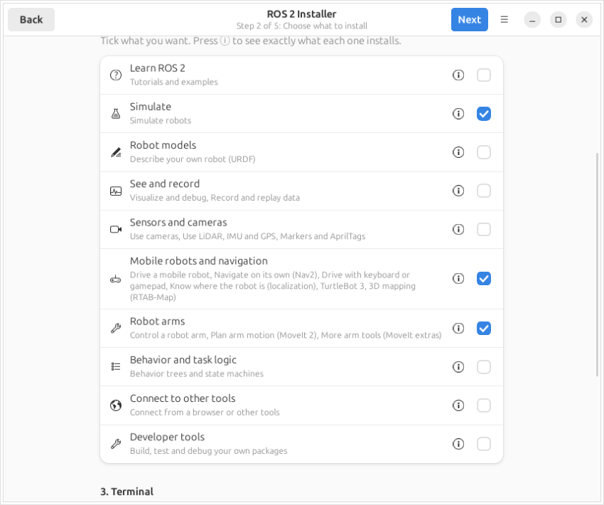
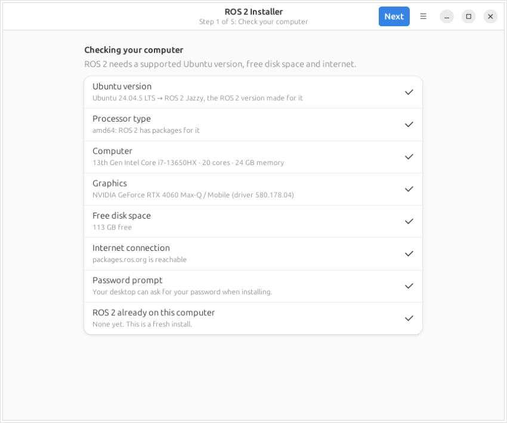
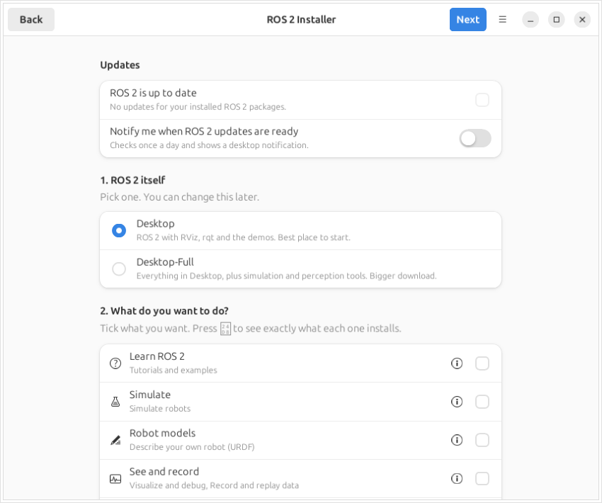
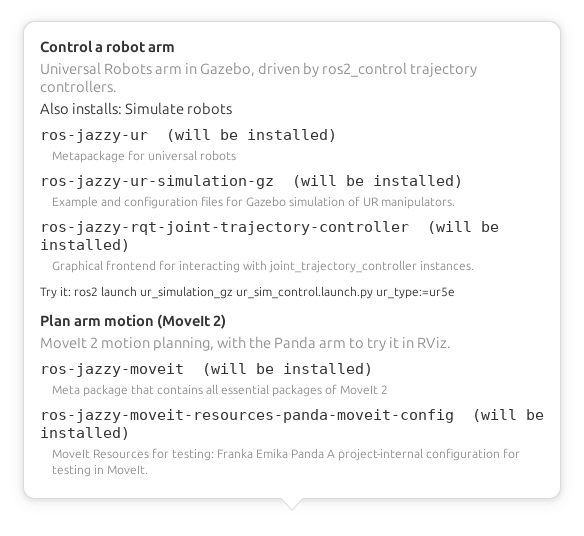
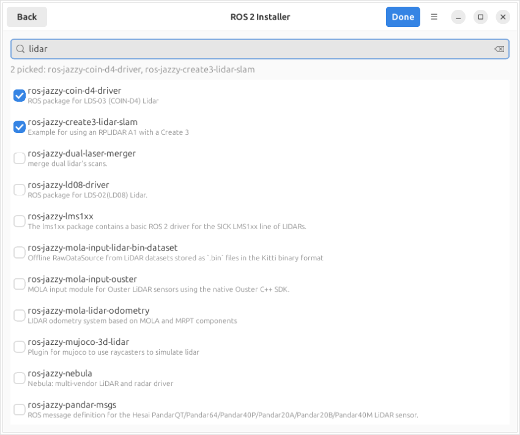
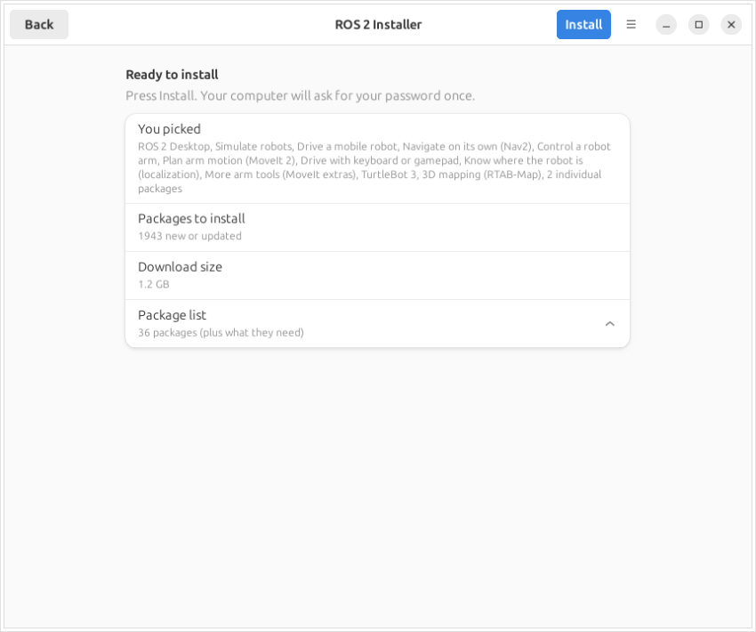
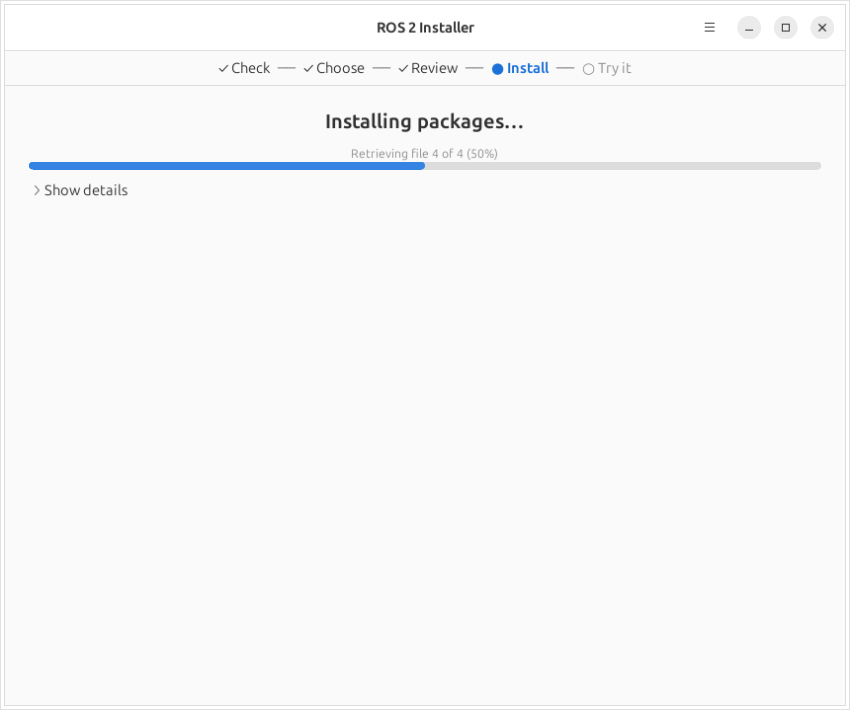
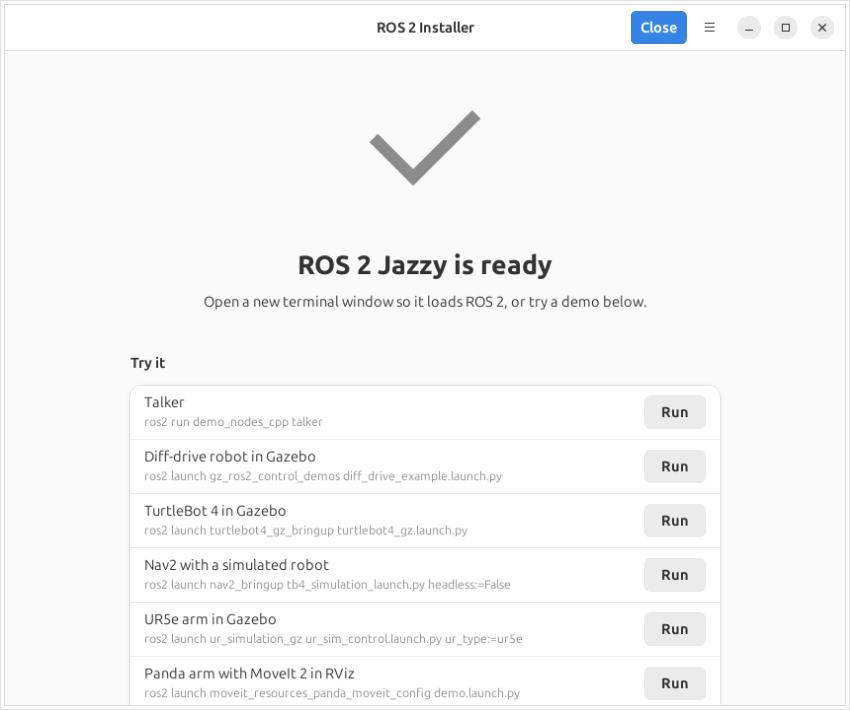

# ROS 2 GUI Installer

[](https://github.com/runtimerobotics/ros2_gui_installer/actions/workflows/ci.yml)
<br>
[](https://releases.ubuntu.com/22.04/)
[](https://releases.ubuntu.com/24.04/)
[](https://releases.ubuntu.com/26.04/)
[](https://linuxmint.com/)
[](https://pop.system76.com/)
<br>
[](#desktops-and-requirements)
[](#desktops-and-requirements)
<br>
[](https://docs.ros.org/en/humble/)
[](https://docs.ros.org/en/jazzy/)
[](https://docs.ros.org/en/lyrical/)
<br>
[](https://www.python.org/)
[](https://www.gtk.org/)
[](https://gnome.pages.gitlab.gnome.org/libadwaita/)
[](#install)
[](https://github.com/runtimerobotics/ros2_gui_installer/commits/main)

A beginner-friendly installer for ROS 2 on Ubuntu and Ubuntu-based Linux, built with GTK4 and libadwaita.
It walks you through five steps: **system check → choose → review → install → try it**.

Created by **Lentin Joseph** · [Runtime Robotics](https://runtimerobotics.com)

<p align="center"></p>

## Quick start

On Ubuntu 22.04, 24.04 or 26.04 (or Linux Mint / Pop!_OS), open a terminal (<kbd>Ctrl</kbd>+<kbd>Alt</kbd>+<kbd>T</kbd>) and run:

```bash
curl -fsSL https://raw.githubusercontent.com/runtimerobotics/ros2_gui_installer/main/install.sh | bash
```

The installer opens by itself. Press **Next**, tick what you want, then press **Install**.
Later, open **ROS 2 Installer** from your app menu. More options are under [Install](#install).

| Ubuntu | ROS 2 |
|---|---|
| 22.04 | Humble |
| 24.04 | Jazzy |
| 26.04 | Lyrical |

Ubuntu-based systems work too, because the installer goes by the Ubuntu release they're built on (`UBUNTU_CODENAME`):
Linux Mint 21 / 22 and Pop!_OS 22.04 / 24.04, for example.

### Desktops and requirements

It works on any desktop on X11 or Wayland: GNOME, KDE Plasma, XFCE, MATE, Cinnamon, LXQt, Budgie.
It uses GTK4 and libadwaita, so it looks like a GNOME app everywhere but follows light and dark mode.

You need:

- Ubuntu 22.04, 24.04 or 26.04 (any flavor), or a system based on one, on amd64 or arm64
- a graphical session and a user with admin (sudo) rights
- internet and about 10 GB of free disk space
- `python3-gi`, `gir1.2-gtk-4.0`, `gir1.2-adw-1`, `python3-yaml`, `librsvg2-common` (the one-line install adds these)
- a **password helper** (polkit agent) so `pkexec` can ask for your password. GNOME, KDE, XFCE, MATE, Cinnamon, LXQt and Budgie all ship one.
  Bare window managers like i3 or Sway often don't. The first page of the installer warns you then; install one with `sudo apt install policykit-1-gnome` and start it with your session.

Optional:

- `notify-send` (package `libnotify-bin`) for update notifications
- a terminal for the **Try it** buttons. It uses your desktop's own terminal: GNOME Terminal or Ptyxis, Konsole, xfce4-terminal, MATE Terminal, QTerminal or LXTerminal. If none of those is installed, it uses the system default terminal.

## How to use it

1. **System check:** the first page checks your Ubuntu version (and which ROS 2 goes with it), free disk space, internet, whether a password helper is running, and whether ROS 2 is already installed. Each item gets a ✓, or a ⚠ or ✗ with a one-line fix.
2. **Choose:** pick ROS 2 itself, then tick the categories you want. You can also update installed ROS 2 packages, set network options, and pick individual packages.
3. **Review:** see what you picked, how many packages that means, and the download size.
4. **Install:** enter your password once. The progress bar fills as apt downloads and then installs, and **Show details** shows the full apt output. If something fails, you get a plain-English message and a **Try again** button.
5. **Try it:** one **Run** button per installed category opens your desktop's terminal running a demo, such as turtlesim, Gazebo, Nav2 or MoveIt 2.

### Screenshots

| | |
|---|---|
| <br>**1. System check** | <br>**2. Choose:** updates and ROS 2 itself |
| <br>**Tick categories** | <br>**ⓘ What's included** |
| <br>**Individual packages** | <br>**3. Review** |
| <br>**4. Install** | <br>**5. Try it** |

Screenshots are from a fresh Ubuntu 24.04 with ROS 2 Jazzy. The colours follow your desktop's theme.

## What you can install

First pick **ROS 2 itself**: Desktop or Desktop-Full, plus `ros-dev-tools` and `rosdep`.
Then tick any of these categories. Each one installs all the sections in it:

| Category | Section | Main packages |
|---|---|---|
| **Learn ROS 2** | Tutorials and examples | `turtlesim`, minimal C++/Python nodes, action and TF2 tutorials, lifecycle demo |
| **Simulate** | Simulate robots | Gazebo, `ros_gz`, `ros2_control` |
| **Robot models** | Describe your own robot (URDF) | `urdf_tutorial`, `xacro`, `robot_state_publisher`, `joint_state_publisher_gui` |
| **See and record** | Visualize and debug | rqt plugins, `rqt_tf_tree`, `tf2_tools`, diagnostics, `rviz_visual_tools` |
| | Record and replay data | `rosbag2` + MCAP, `rqt_bag`, PlotJuggler |
| **Sensors and cameras** | Use cameras | `vision_opencv`, `image_pipeline`, `v4l2_camera`, RealSense |
| | Markers and AprilTags | `apriltag_ros`, `aruco_opencv` |
| | Use LiDAR, IMU and GPS | Velodyne, Hokuyo (`urg_node`), `imu_tools`, `nmea_navsat_driver`, `pcl_ros` |
| **Mobile robots and navigation** | Drive a mobile robot | TurtleBot 4 simulation, SLAM Toolbox |
| | Navigate on its own | Nav2 |
| | Drive with keyboard or gamepad | `teleop_twist_keyboard`, `teleop_twist_joy`, `joy` |
| | Know where the robot is | `robot_localization`, AMCL, Cartographer |
| | TurtleBot 3 | `turtlebot3`, Gazebo worlds |
| | 3D mapping | RTAB-Map |
| **Robot arms** | Control a robot arm | Universal Robots in Gazebo |
| | Plan arm motion | MoveIt 2 with the Panda demo |
| | More arm tools | MoveIt Servo, `moveit_py`, CHOMP, `pick_ik`, Robotiq gripper |
| **Behavior and task logic** | Behavior trees and state machines | BehaviorTree.CPP, `py_trees_ros` + tutorials, SMACH, FlexBE |
| **Connect to other tools** | Connect from a browser or other tools | rosbridge, Foxglove bridge |
| **Developer tools** | Build, test and debug your own packages | ament linters, clang-format, launch testing, `generate_parameter_library`, tracing, SROS2 |

Each category is one row with a tick box on the right. When everything in a category is already installed, the row says **Installed**.
Press **ⓘ** on a category to see exactly what it installs: each section with every package and its description, whether you already have it, and the demo command.

Some sections need another category: Nav2, both TurtleBots and the arm need **Simulate**, so ticking **Mobile robots and navigation** or **Robot arms** ticks **Simulate** too.

If a section isn't released yet for your ROS 2 version, the category's row says so and installs the rest; for example, TurtleBot 4 isn't released for Lyrical yet.
When a single package is missing for one version (for example PlotJuggler or Cartographer on Lyrical), that version gets the rest of the section without it.

### Updates

The **Updates** group at the top of the choose page shows how many of your installed ROS 2 packages have updates waiting. Tick it to update them along with whatever else you install.
The installer updates only packages you already have, with `apt-get install --only-upgrade`, so it doesn't change which packages apt marks as manually installed.

Turn on **Notify me when ROS 2 updates are ready** to get a desktop notification when updates are waiting.
This sets up a daily systemd user timer (`ros2-gui-installer-updates.timer`) that runs `ros2_installer.py --check-updates`.
The check reads the package lists from Ubuntu's own daily apt refresh, so it never asks for a password.
Turn the switch off to remove the timer. You can also run the check by hand:

```bash
~/.local/bin/ros2-gui-installer --check-updates
```

### Individual packages

Already know which package you need? Open **5. Individual packages → Pick individual packages** on the choose page.
It lists every `ros-<distro>-*` package in the ROS 2 repository (about 2,000 for Jazzy, without debug-symbol packages).
Search by any word in the name or description (`imu`, `lidar`, `moveit servo`), then tick the packages you want.
Packages you already have are marked **Installed**.
The packages you pick go into the same install as the sections above.

### Network settings (for classrooms and labs)

The installer can also change three network settings:

- **ROS Domain ID (0–101):** give each student or robot its own number so they don't see each other's topics.
- **Middleware (RMW):** Default (Fast DDS), Cyclone DDS or Zenoh. The installer installs the package for the one you pick.
- **This computer only:** keeps ROS 2 traffic on this computer. On Humble it sets `ROS_LOCALHOST_ONLY=1`; on newer versions it sets `ROS_AUTOMATIC_DISCOVERY_RANGE=LOCALHOST`.

The settings are saved to `~/.config/ros2-gui-installer/env.sh`, and `~/.bashrc` loads that file, so they apply to every new terminal.
To change them, run the installer again; it starts from the values you saved last time.

## Install

Open a terminal (<kbd>Ctrl</kbd>+<kbd>Alt</kbd>+<kbd>T</kbd>) and paste:

```bash
curl -fsSL https://raw.githubusercontent.com/runtimerobotics/ros2_gui_installer/main/install.sh | bash
```

This command:

1. installs the few Ubuntu packages the GUI needs (GTK4, libadwaita, PyYAML), asking for your password if any are missing
2. downloads the installer to `~/.local/share/ros2-gui-installer`
3. adds **ROS 2 Installer** to your app menu and a `ros2-gui-installer` command
4. opens the installer

Run it as your normal user, without `sudo`. The installer asks for your password itself, once, right before it installs ROS 2.

If you'd rather read the script before running it:

```bash
curl -fsSLO https://raw.githubusercontent.com/runtimerobotics/ros2_gui_installer/main/install.sh
less install.sh
bash install.sh
```

### Open it later

Pick **ROS 2 Installer** from the app menu, or run `~/.local/bin/ros2-gui-installer`.
You can run it again any time to add more sections.

### Update

Run the same `curl … | bash` command again. It replaces the old copy with the latest version.

### Uninstall the GUI

This removes only the installer app, not ROS 2:

```bash
rm -rf ~/.local/share/ros2-gui-installer ~/.local/bin/ros2-gui-installer ~/.local/share/applications/ros2-gui-installer.desktop
```

### Run from a git clone (for development)

```bash
sudo apt install python3-gi gir1.2-gtk-4.0 gir1.2-adw-1 python3-yaml
git clone https://github.com/runtimerobotics/ros2_gui_installer.git
cd ros2_gui_installer && ./ros2_installer.py
```

## How it works

- `catalog.yaml` lists every section with its packages and demo command.
  To add a section, add an entry there; you don't need to change any code.
- `ros2_installer.py` is the GUI. It runs as your normal user.
- `helper.sh` is the only part that runs as root. It refuses any package name that isn't a ROS 2 package. If the ROS 2 apt repository is missing, it adds it using the official [`ros2-apt-source`](https://github.com/ros-infrastructure/ros-apt-source) package. Then it runs `apt-get install` for new packages, and `apt-get install --only-upgrade` for updates.
- The ROS 2 version comes from `UBUNTU_CODENAME` in `/etc/os-release` (jammy → Humble, noble → Jazzy, resolute → Lyrical). That's why Ubuntu-based systems work too.

## Test

```bash
./test_installer.py
```

The test checks the parsers and the helper's name filter. It also checks that every catalog package exists in apt for the ROS 2 version on this machine.

[GitHub Actions](.github/workflows/ci.yml) runs the same test in Ubuntu 22.04, 24.04 and 26.04 containers with the ROS 2 apt repository added. So every push checks the catalog against Humble, Jazzy and Lyrical.
It also runs every Monday, to catch packages that get removed from apt.
If a section is expected to be missing for a version, mark it with `not_released_for: [<distro>]` in `catalog.yaml`. The test then fails as soon as that section's packages are released, so you know to remove the marker.

## About

ROS 2 Installer is created and maintained by **Lentin Joseph** at [Runtime Robotics](https://runtimerobotics.com).
Found a bug or have an idea? [Open an issue](https://github.com/runtimerobotics/ros2_gui_installer/issues).
In the app, open the **☰** menu → **About ROS 2 Installer**.

ROS and ROS 2 are trademarks of Open Robotics. This installer is an independent project, not affiliated with or endorsed by Open Robotics.
